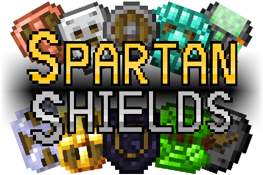
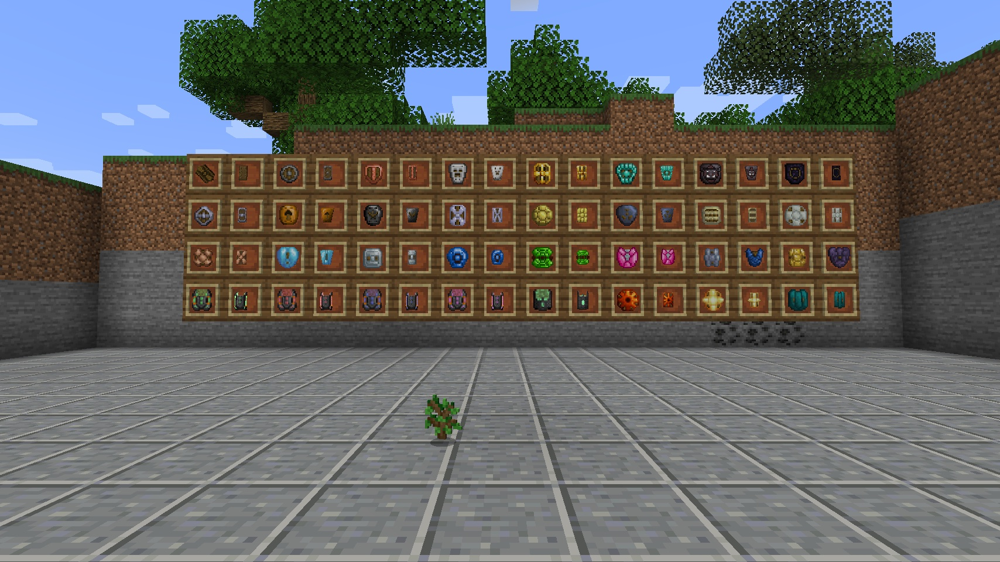
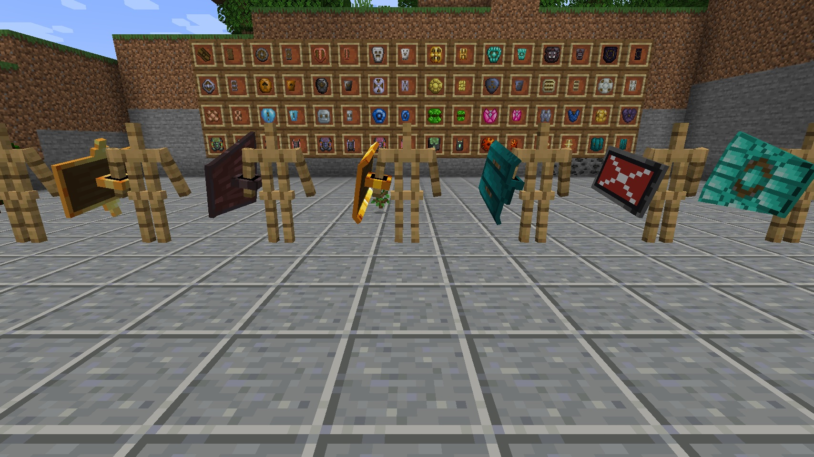
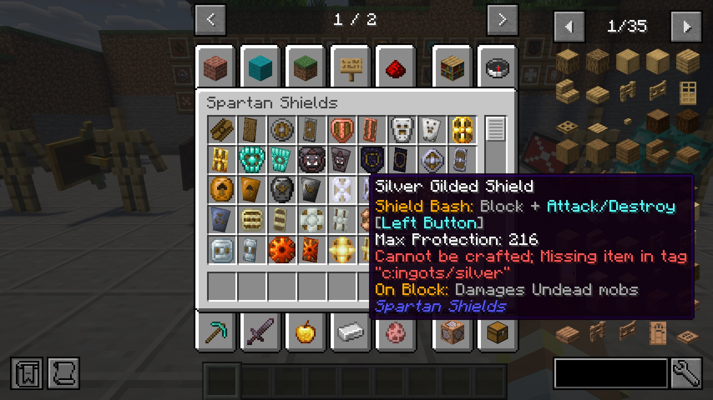
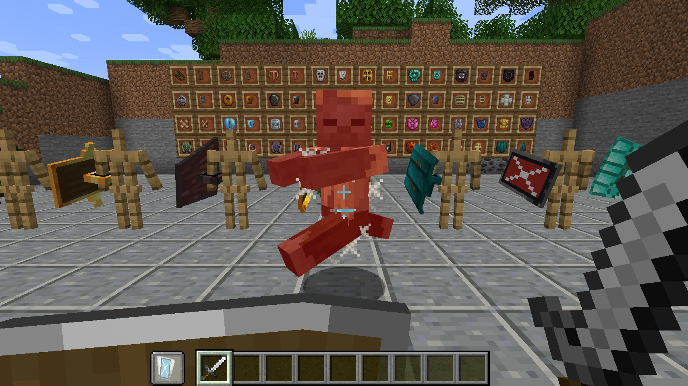
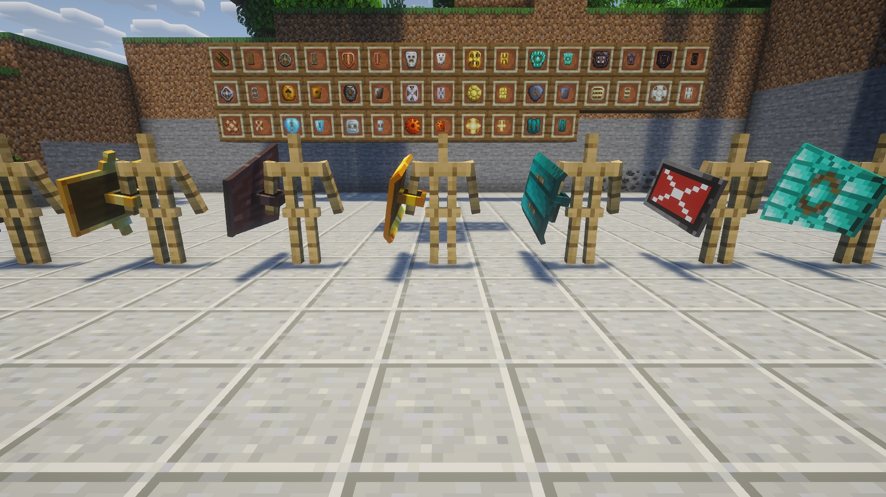
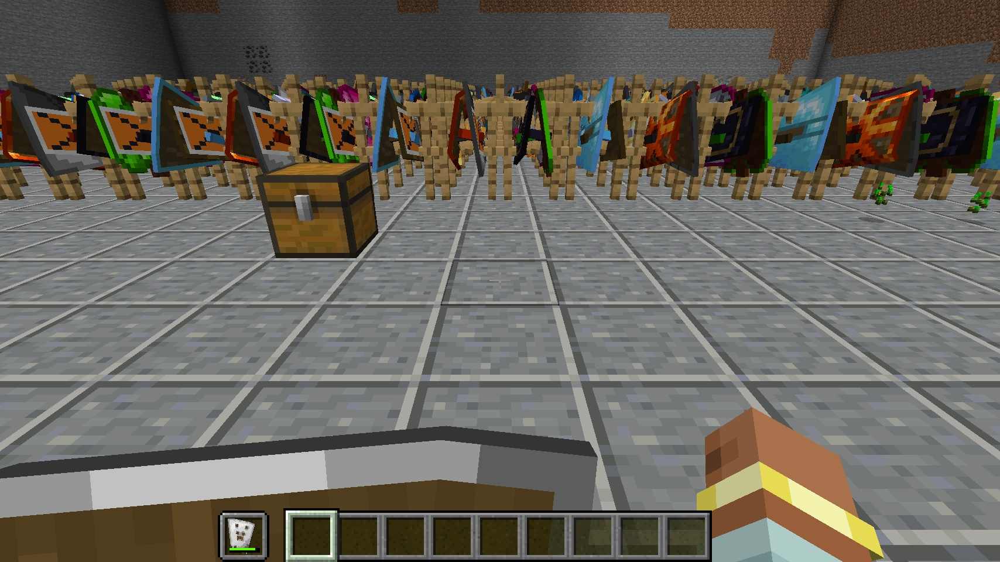

# Spartan Shields — NeoForge & Fabric 1.21.11

**Raise your shield. Then hit them with it.**

An unofficial port of **[Spartan Shields](https://www.curseforge.com/minecraft/mc-mods/spartan-shields)** 3.1.1
by **ObliviousSpartan** from Minecraft 1.20.1 (Forge) to **NeoForge and Fabric 1.21.11**, with all of its content. This is the 1.21.11
branch; 1.21.1 is on [`main`](../../tree/main).

---

## 🛡️ About the mod

Spartan Shields adds a whole armoury of shields to Minecraft — from a crude wooden board to netherite and
energy-powered riot shields — and turns blocking into an attack.

- **64 shields**: a basic and a tower variant for wood, stone, copper, iron, gold, diamond, netherite and obsidian,
  plus the metals of other mods (tin, bronze, steel, silver, electrum, lead, nickel, invar, constantan, platinum,
  aluminium, signalum, lumium, enderium) and shields for **Mekanism**, **Ender IO** and **Botania**
- **Tower shields** — bigger, tougher (+25 % durability), drawn as 3D models, and they take **banners** just like the
  vanilla shield
- **Shield Bash** — while blocking, press attack to slam the shield into your foe: a little damage and a big knockback.
  Tower shields hit everything around the target
- **Three enchantments**: **Spikes** (hurts whoever hits your raised shield), **Firebrand** (your bash sets foes on fire)
  and **Payback** (blocked damage charges your next bash)
- **Special shields**: silver hurts the undead, signalum weakens, lumium makes foes glow, enderium slows them, obsidian
  is heavy but nearly unmovable, and the powered shields run on energy instead of durability
- **Configurable**: durability of every material, bash cooldowns, energy use, disable any modded material or all of them
- **Six languages**: English, Russian, Ukrainian, German, Spanish, Brazilian Portuguese (all but English are machine
  translations, corrections welcome)

## 📸 Screenshots

  
  
  
  
  
  

## ⚔️ Shield Bash

| | |
| --- | --- |
| **How** | Hold a shield up (right click) and press **attack** — or bind the *Alternate Shield Bash* key in Controls |
| **Effect** | 1 damage (+ the Payback charge), knockback 1 + Knockback level, the target is set on fire with Firebrand |
| **Tower shields** | Also hit the foes around the target |
| **Cost** | 5 durability, then a cooldown of 1.5 s (tower shields 2.5 s) |

Works with the vanilla shield too (`#spartanshields:shields_with_bash`).

## 🔩 Shields for other mods

The modded shields appear only when their material exists: a shield made of tin needs a mod that adds tin ingots
(`c:ingots/tin`), the Mekanist's shields need **Mekanism**, the Dark Steel Riot Shields need **Ender IO**, the
Manasteel, Terrasteel and Elementium shields need **Botania**. Until then their recipe is off and the tooltip says what is
missing. Shields of a mod that is not installed, and shields you disable in the config, are left out of the creative tab
and JEI. Powered shields are charged like any other energy item (Mekanism, Ender IO, …) and keep their charge when
upgraded. Mekanism, Ender IO and Botania have no 1.21.11 version, so on 1.21.11 their shields stay off; the
powered shields take the energy of other tech mods (NeoForge energy, on Fabric Team Reborn Energy).

## 📦 Requirements

**NeoForge**

- **NeoForge 21.11.48** or newer for Minecraft **1.21.11**.

No other mods needed.

**Fabric**

- **Fabric Loader 0.19.5** or newer for Minecraft **1.21.11**.
- **[Fabric API](https://modrinth.com/mod/fabric-api)** and **[Forge Config API Port](https://modrinth.com/mod/forge-config-api-port)** 21.11.1 or newer (the settings).

On Fabric the powered shields store **Team Reborn Energy** (the energy of Fabric tech mods, included in the jar).

Both: required on the client and the server. Settings: `config/spartanshields-common.toml`.

## 🔧 What changed in the port

Content, recipes and numbers are those of 3.1.1. Bugs of the original that the port fixes:

| Original issue | Fix |
| --- | --- |
| [#10](https://github.com/ObliviousSpartan/SpartanShields/issues/10) Out-of-memory crash on launch in big packs, "absurd sized texture for banner patterns" | The shield texture atlas took every entity texture of every mod; it now only holds the 58 shield textures |
| [#1](https://github.com/ObliviousSpartan/SpartanShields/issues/1) `vanilla_only` has no effect | It now also turns off the Botania and Ender IO shields, and the disabled shields leave the creative tab |
| [#6](https://github.com/ObliviousSpartan/SpartanShields/issues/6) Uncraftable shields keep recipes and clutter JEI | Banner recipes follow the shield's own recipe; shields of missing mods and disabled shields are hidden from the creative tab and JEI |
| [#4](https://github.com/ObliviousSpartan/SpartanShields/issues/4) "Block + [LEFT BUTTON]" — which button? | The tooltip names the action and its key: "Block + Attack/Destroy [Left Button]" |
| [#7](https://github.com/ObliviousSpartan/SpartanShields/issues/7) Shields only block once | Not reproducible in the port: a real attacker for 30 s, every hit from the front blocked |

Found while porting:

- Powered shields now use the configured energy per point of blocked damage (50 FE), as their tooltip always said —
  since 1.16 they only used 1 FE. They no longer accept negative energy (which drained them).
- The server checks the reach of a Shield Bash (a modified client could bash any entity anywhere).
- Spikes always works with two Spikes shields; the "uncraftable" tooltip follows data pack reloads; the alternate bash key
  has a name; the Dark Steel Riot Tower Shield takes banners like the other tower shields.

The full list, with the reasons and what 1.21 changed, is in **[PORTLOG.md](PORTLOG.md)**.

## ✅ Tested

- **Functional** (22 checks, on NeoForge 21.11.48 and Fabric Loader 0.19.5 with Fabric API 0.141.6): all recipes, Shield
  Bash, the three enchantments, banners, energy, config; tower shields with banners and light layers look as on 1.21.1.
- **Release jar** on a real NeoForge 21.11.48 server and a dedicated Fabric server; the scene on a Fabric production
  client.
- **Compatibility**: Sodium 0.8.14, Iris 1.10.8, Lithium 0.21.4, FerriteCore 8.2.0, Jade 21.1. On Fabric with the
  Complementary shaders on; on NeoForge with the shader pack off, as Iris 1.10.8 for NeoForge crashes on any enchanted
  item in hand (vanilla's too) in its shadow pass.
- Not on 1.21.11: Mekanism, Ender IO, Botania (no 1.21.11 versions), so their shields stay off. No stress scene for
  1.21.11 yet.

## ❤️ Credits

- **Spartan Shields** — made by **ObliviousSpartan** (name by Evinsta) ·
  [CurseForge](https://www.curseforge.com/minecraft/mc-mods/spartan-shields) ·
  [Modrinth](https://modrinth.com/mod/spartan-shields) ·
  [source](https://github.com/ObliviousSpartan/SpartanShields). All the content, art and ideas are theirs.
- **Port** to NeoForge and Fabric 1.21.1 and 1.21.11 — [Vladeezyy](https://github.com/Vladeezyy).
- Bugs of **this port**: [issues](../../issues). Please don't report port bugs to the original author.

### License

The port is licensed under the **GNU LGPL 3.0 only** ([LICENSE](LICENSE), with the GPL 3.0 it refers to in
[licenses/COPYING](licenses/COPYING)). Copyright (c) 2026 Vladeezyy for the port.
The original Spartan Shields is © ObliviousSpartan under the **Apache License 2.0**, kept in
[licenses/LICENSE-APACHE](licenses/LICENSE-APACHE); its code and art stay under that license.
Forks are welcome: they must stay open, under the same license, and credit the authors.
Please download the mod only from the official pages.

---

<b>🇷🇺 Описание на русском</b>

 

**Поднимите щит. А потом ударьте им.**

Неофициальный порт мода **[Spartan Shields](https://www.curseforge.com/minecraft/mc-mods/spartan-shields)** 3.1.1
от **ObliviousSpartan** с Minecraft 1.20.1 (Forge) на **NeoForge и Fabric 1.21.11** — со всем содержимым. Это ветка 1.21.11; 1.21.1 — в
[`main`](../../tree/main).

<b>🛡️ О моде</b>

Spartan Shields добавляет в Minecraft целый арсенал щитов — от грубой деревянной доски до незеритовых и энергетических
щитов спецназа — и превращает блок в атаку.

- **64 щита**: обычный и башенный вариант из дерева, камня, меди, железа, золота, алмаза, незерита и обсидиана, а также
  из металлов других модов (олово, бронза, сталь, серебро, электрум, свинец, никель, инвар, константан, платина,
  алюминий, сигналум, люмиум, эндериум) и щиты для **Mekanism**, **Ender IO** и **Botania**
- **Башенные щиты** — больше, прочнее (+25 % прочности), рисуются 3D-моделями и принимают **баннеры**, как ванильный щит
- **Удар щитом** — держа блок, нажмите атаку, чтобы врезать щитом по врагу: немного урона и сильное отбрасывание.
  Башенные щиты задевают всех вокруг цели
- **Три зачарования**: **Spikes** (ранит того, кто бьёт по поднятому щиту), **Firebrand** (удар щитом поджигает) и
  **Payback** (заблокированный урон заряжает следующий удар щитом)
- **Особые щиты**: серебряный ранит нежить, сигналум ослабляет, люмиум подсвечивает врагов, эндериум замедляет, обсидиановый
  тяжёлый, но почти не сдвигается, а энергетические щиты тратят энергию вместо прочности
- **Настройки**: прочность каждого материала, перезарядка удара, расход энергии, отключение любого модового материала
  или всех сразу
- **Шесть языков**: английский, русский, украинский, немецкий, испанский, бразильский португальский (все, кроме
  английского, — машинный перевод, исправления приветствуются)

<b>⚔️ Удар щитом</b>

| | |
| --- | --- |
| **Как** | Поднимите щит (правая кнопка) и нажмите **атаку** — или назначьте клавишу *Alternate Shield Bash* в управлении |
| **Эффект** | 1 урона (+ заряд Payback), отбрасывание 1 + уровень Отдачи, поджог с Firebrand |
| **Башенные щиты** | Задевают и врагов вокруг цели |
| **Цена** | 5 прочности, затем перезарядка 1,5 с (башенные — 2,5 с) |

Работает и с ванильным щитом (`#spartanshields:shields_with_bash`).

<b>🔩 Щиты для других модов</b>

Модовые щиты доступны, только когда есть их материал: оловянному щиту нужен мод с оловянными слитками (`c:ingots/tin`),
щитам механика — **Mekanism**, щитам спецназа из тёмной стали — **Ender IO**, щитам из манастали, террастали и
элементиума — **Botania**. До этого их рецепт выключен, а в подсказке написано, чего не хватает. Энергетические щиты
заряжаются как любой энергетический предмет (Mekanism, Ender IO, …) и сохраняют заряд при улучшении. Щиты
неустановленных модов и щиты, отключённые в конфиге, не показываются в творческой вкладке и в JEI. У Mekanism, Ender IO и Botania
нет версий под 1.21.11, поэтому на 1.21.11 их щиты выключены; щиты с питанием заряжаются от других технических модов
(энергия NeoForge, на Fabric — Team Reborn Energy).

<b>📦 Требования</b>

**NeoForge**

- **NeoForge 21.11.48** или новее для Minecraft **1.21.11**.

Других модов не нужно.

**Fabric**

- **Fabric Loader 0.19.5** или новее для Minecraft **1.21.11**.
- **[Fabric API](https://modrinth.com/mod/fabric-api)** и **[Forge Config API Port](https://modrinth.com/mod/forge-config-api-port)** 21.11.1 или новее (настройки).

На Fabric щиты с питанием хранят энергию **Team Reborn Energy** (энергия технических модов Fabric, входит в jar).

Для обоих: нужен и на клиенте, и на сервере. Настройки: `config/spartanshields-common.toml`.

<b>🔧 Что изменилось в порте</b>

Содержимое, рецепты и числа — как в 3.1.1. Ошибки оригинала, исправленные в порте:

| Issue оригинала | Исправление |
| --- | --- |
| [#10](https://github.com/ObliviousSpartan/SpartanShields/issues/10) Вылет из-за нехватки памяти при запуске больших сборок, «огромная текстура баннеров» | В атлас текстур щитов попадали все текстуры сущностей всех модов; теперь там только 58 текстур щитов |
| [#1](https://github.com/ObliviousSpartan/SpartanShields/issues/1) `vanilla_only` не действует | Теперь отключает и щиты Botania и Ender IO, а отключённые щиты пропадают из творческой вкладки |
| [#6](https://github.com/ObliviousSpartan/SpartanShields/issues/6) У некрафтабельных щитов остаются рецепты, они засоряют JEI | Рецепты баннера следуют за рецептом самого щита; щиты отсутствующих модов и отключённые щиты скрыты из творческой вкладки и JEI |
| [#4](https://github.com/ObliviousSpartan/SpartanShields/issues/4) «Block + [LEFT BUTTON]» — какая кнопка? | Подсказка называет действие и клавишу: «Block + Attack/Destroy [Left Button]» |
| [#7](https://github.com/ObliviousSpartan/SpartanShields/issues/7) Щит блокирует только один раз | В порте не воспроизводится: настоящий противник 30 секунд, все удары спереди заблокированы |

Найдено при портировании:

- Энергетические щиты тратят настроенное количество энергии на единицу заблокированного урона (50 FE), как и писала их
  подсказка, — с версии 1.16 они тратили всего 1 FE. Отрицательную энергию (которая их разряжала) больше не принимают.
- Сервер проверяет дальность удара щитом (изменённый клиент мог ударить любую сущность где угодно).
- Spikes всегда работает с двумя щитами со Spikes; подсказка «нельзя скрафтить» обновляется после перезагрузки датапаков;
  у дополнительной клавиши удара есть название; башенный щит спецназа из тёмной стали принимает баннеры, как остальные.

Полный список, с причинами и изменениями 1.21, — в **[PORTLOG.md](PORTLOG.md)** (на английском).

<b>✅ Проверено</b>

- **Функционально** (22 проверки, на NeoForge 21.11.48 и Fabric Loader 0.19.5 с Fabric API 0.141.6): все рецепты, удар
  щитом, три зачарования, баннеры, энергия, конфиг; башенные щиты, баннеры и световые слои выглядят как на 1.21.1.
- **Release jar** на настоящем сервере NeoForge 21.11.48 и выделенном сервере Fabric; сцена на production-клиенте Fabric.
- **Совместимость**: Sodium 0.8.14, Iris 1.10.8, Lithium 0.21.4, FerriteCore 8.2.0, Jade 21.1. На Fabric — с шейдерами
  Complementary; на NeoForge — без шейдерпака: Iris 1.10.8 для NeoForge падает в своём проходе теней на любом
  зачарованном предмете в руке (и ванильном тоже).
- Нет на 1.21.11: Mekanism, Ender IO, Botania (версий под 1.21.11 нет), поэтому их щиты выключены. Стресс-сцены для
  1.21.11 пока не было.

<b>❤️ Авторы</b>

- **Spartan Shields** — автор **ObliviousSpartan** (название придумал Evinsta) ·
  [CurseForge](https://www.curseforge.com/minecraft/mc-mods/spartan-shields) ·
  [Modrinth](https://modrinth.com/mod/spartan-shields) ·
  [исходники](https://github.com/ObliviousSpartan/SpartanShields). Всё содержимое, графика и идеи принадлежат им.
- **Порт** на NeoForge и Fabric 1.21.1 и 1.21.11 — [Vladeezyy](https://github.com/Vladeezyy).
- Ошибки **этого порта**: [issues](../../issues). Пожалуйста, не сообщайте об ошибках порта автору оригинала.

**Лицензия.** Порт выходит под **GNU LGPL 3.0 only** ([LICENSE](LICENSE), и GPL 3.0, на которую она ссылается,
в [licenses/COPYING](licenses/COPYING)). Copyright (c) 2026 Vladeezyy за порт.
Оригинальный Spartan Shields © ObliviousSpartan под **Apache License 2.0**, её текст сохранён в
[licenses/LICENSE-APACHE](licenses/LICENSE-APACHE); код и графика оригинала остаются под ней.
Форки приветствуются: они должны оставаться открытыми, под той же лицензией и с указанием авторов.
Пожалуйста, скачивайте мод только с официальных страниц.

